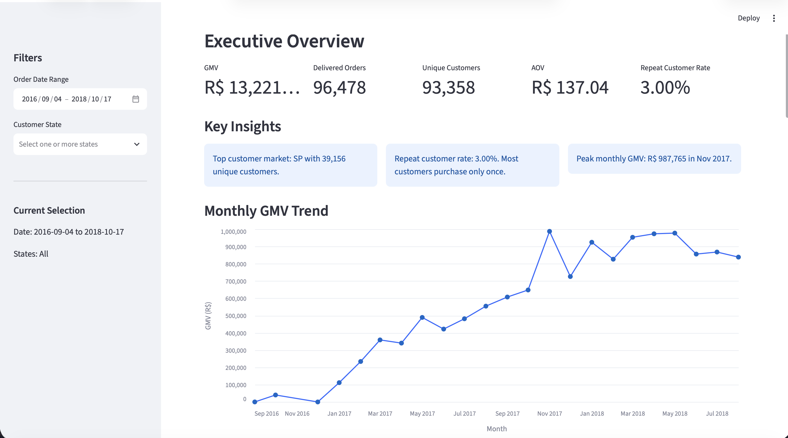

# E-commerce Customer Analytics

An end-to-end e-commerce analytics project built with Python, SQL, Streamlit, and Altair using the Olist Brazilian E-commerce dataset.

The project focuses on marketplace performance, customer behavior, product trends, logistics, sellers, and payment patterns through a structured data-cleaning workflow, SQL analysis, and an interactive dashboard.

## Dashboard Preview



The dashboard supports interactive filtering by order date and customer state.

## Live Demo

👉 [Open the Streamlit Dashboard](https://us-ecommerce-customer-analytics-cfdztfrehqiy4wkyjdgba8.streamlit.app/)

## Project Overview

This project analyzes an e-commerce marketplace from multiple business perspectives:

- Executive performance metrics
- Customer behavior and retention
- Product category performance
- Delivery and operational efficiency
- Seller performance
- Payment behavior

The final output is an interactive Streamlit dashboard with date and customer-state filters.

## Key Business Metrics

The dashboard currently includes:

- GMV
- Delivered Orders
- Unique Customers
- Average Order Value (AOV)
- Repeat Customer Rate
- Monthly GMV Trend
- Average Delivery Time
- Late Delivery Rate

## Dashboard Sections

### Executive Overview
Provides a high-level summary of marketplace performance, including GMV, order volume, customer count, AOV, repeat customer rate, monthly GMV trends, and dynamic key insights.

### Customer Analysis
Analyzes:
- One-time vs. repeat customers
- Top customer states
- Geographic concentration of customers

### Product Analysis
Compares:
- Top product categories by GMV
- Top product categories by number of orders

### Operations Analysis
Evaluates:
- Average delivery time
- Late delivery rate
- Monthly delivery-time trends

### Seller Analysis
Analyzes:
- Top seller states
- Top sellers by GMV

Seller IDs are anonymized in the dashboard using ranked labels such as `Seller 1`, `Seller 2`, etc., while the original seller ID remains available in the chart tooltip.

### Payment Analysis
Analyzes:
- Payment value by payment method
- Orders by number of installments

## Data Definitions

The project uses the following core business definitions:

- **GMV** = sum of `order_items.price`
- **Freight** = sum of `order_items.freight_value`
- **Order Value** = GMV + Freight
- **Customer Payment** = sum of `payments.payment_value`

For dashboard consistency, GMV-related metrics are calculated using delivered orders only.

## Dataset

Source: Olist Brazilian E-commerce Public Dataset

The dataset contains multiple relational tables covering:

- Orders
- Customers
- Order items
- Payments
- Reviews
- Products
- Sellers
- Geolocation
- Product category translations

Raw data is excluded from the GitHub repository through `.gitignore`.

## Project Structure

```text
us-ecommerce-customer-analytics/
│
├── dashboard/
│   └── app.py
│
├── data/
│   ├── raw/
│   └── processed/
│
├── notebooks/
│
├── sql/
│
├── .gitignore
├── requirements.txt
└── README.md
```

## Tools & Technologies

- Python
- pandas
- NumPy
- SQL
- Streamlit
- Altair
- Jupyter Notebook
- Git / GitHub

## Running the Project Locally

Create and activate a virtual environment, then install the dependencies:

```bash
python -m pip install -r requirements.txt
```

Run the Streamlit dashboard:

```bash
python -m streamlit run dashboard/app.py
```

## Interactive Filters

The dashboard supports:

- Order date range filtering
- Customer state filtering
- Single-state or multi-state selection

All downstream KPIs and visualizations update dynamically based on the selected filters.

## Key Insights

The dashboard is designed to surface business insights such as:

- Customer retention is relatively low, with most customers purchasing only once.
- Customer activity is geographically concentrated in a small number of states.
- Product categories with the highest order volume are not always the same categories that generate the highest GMV.
- Seller activity is geographically concentrated.
- Delivery performance can be monitored over time using average delivery days and late-delivery rates.

## Future Improvements

Potential extensions include:

- RFM customer segmentation
- Cohort retention analysis
- Customer lifetime value estimation
- Seller concentration metrics
- Geographic visualizations
- Additional drill-down filters
- Cloud deployment of the Streamlit dashboard


## Author

Shunan Wu  
M.S. Applied Statistics and Data Science, UCLA
